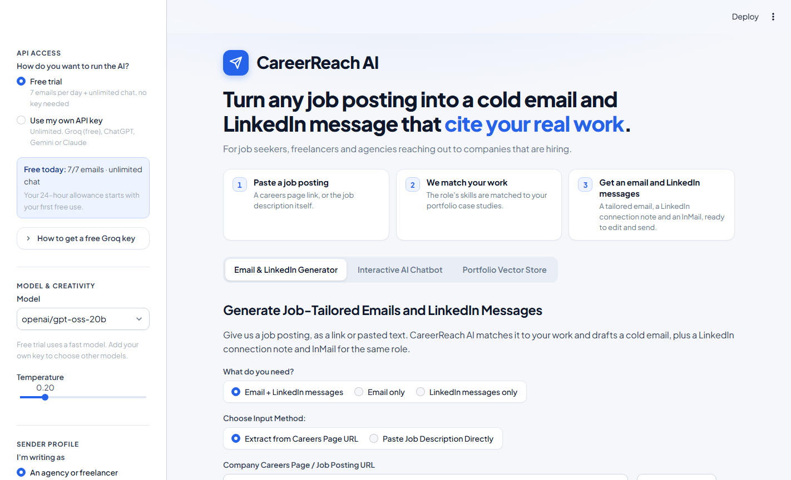
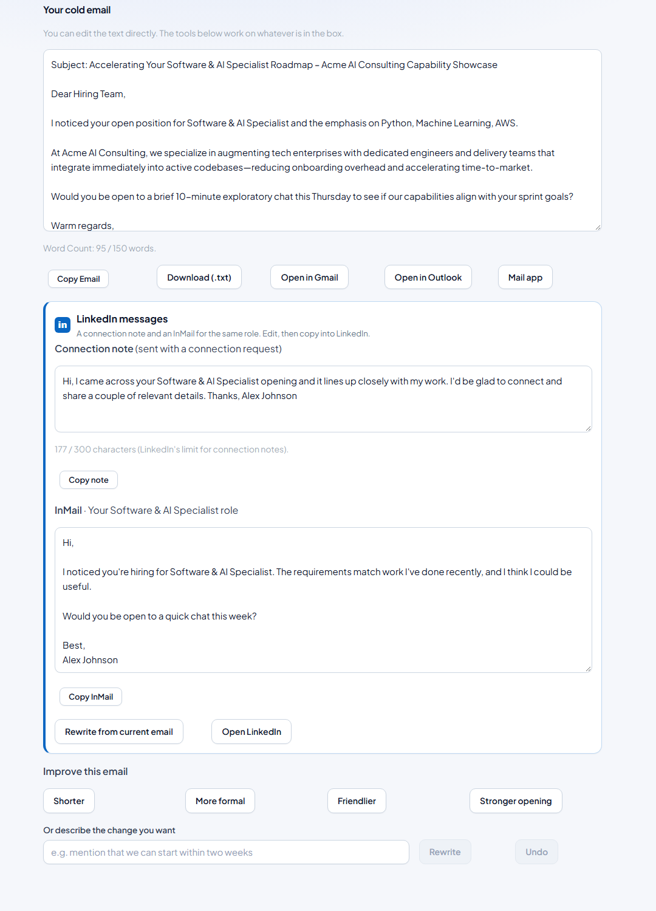
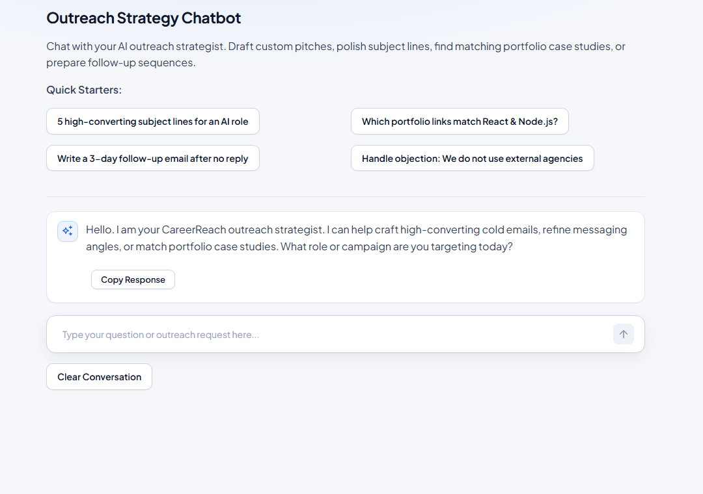

# 🚀 CareerReach AI

[](https://careerreach-ai.streamlit.app/)
[](https://careerreach-ai.streamlit.app/)

> 🌐 **Live Demo**: [https://careerreach-ai.streamlit.app/](https://careerreach-ai.streamlit.app/)

**CareerReach AI** is an AI-powered B2B cold outreach platform and interactive sales advisor built with **Groq**, **LangChain**, **ChromaDB**, and **Streamlit**.

It extracts job postings directly from company career page URLs (or manual descriptions), matches relevant company portfolio case studies from a vector database, writes personalized cold emails, and features a built-in **Interactive AI Chatbot** for strategic outreach guidance.

---

## 📸 Screenshots



| Email tools | Outreach chatbot |
|---|---|
|  |  |

---

## ✨ Features

- 📧 **Cold Email Generator**:
  - Read job postings from a careers page URL or paste the description directly. Greenhouse, Lever and Workday postings are read through their public APIs, and blocked or JavaScript-only pages get a clear message.
  - Two modes: **agency or freelancer** pitching services, or **job seeker** applying with an uploaded resume (PDF, Word or text).
  - Skill match score showing which of the job's skills were found in your resume or portfolio, and which were not.
  - Automatically extracts key details: Role, Experience, Skills, and Responsibilities.
  - Generates personalized, high-converting cold emails tailored to the role.
  - Edit the email in place, or rewrite it with one click (shorter, more formal, friendlier, stronger opening) or your own instruction, with Undo.
  - Subject-line ideas with a reason for each, and a day 3 / 7 / 14 follow-up sequence.
  - LinkedIn connection note (kept within LinkedIn's 300-character limit) and InMail.
  - Open the email in Gmail, Outlook or your mail app, or copy or download it.
  - Thumbs up/down feedback on each email (only settings and the rating are logged, never the email text).

- 🤖 **Interactive AI Chatbot**:
  - Real-time conversational AI sales & outreach advisor powered by the AI provider you choose.
  - Conversational memory for multi-turn discussions.
  - Brainstorms catchy subject lines, follow-up sequences, and objection handlers.
  - Queries indexed portfolio case studies to suggest the best angles.

- 💼 **ChromaDB Vector Store**:
  - Semantically searches portfolio case studies based on extracted job tech stacks.
  - Live search and interactive addition of new portfolio records.

- 🔑 **Free Trial or Your Own Key**:
  - Free trial on the host's key: 7 emails per day and unlimited chat, with the reset time shown.
  - Or bring your own key for **Groq** (free), **OpenAI (ChatGPT)**, **Google Gemini** or **Anthropic Claude**, with a short in-app guide for each.
  - Keys stay in the browser session only and are never saved or logged.

- ⚙️ **Customizable Sender Persona**:
  - Customize sender name, company name, role, email tone, and Groq LLM model (`openai/gpt-oss-120b`, `qwen/qwen3.8-27b`, `openai/gpt-oss-20b`).

---

## 📁 Repository Structure

```
├── app/
│   ├── main.py            # Streamlit multi-tab application & UI
│   ├── chains.py          # LLM chains (extraction, cold email, rewrite, subject lines, follow-ups, chatbot)
│   ├── providers.py       # Groq, OpenAI, Gemini and Claude clients
│   ├── portfolio.py       # Per-visitor ChromaDB portfolio (in memory)
│   ├── usage.py           # Free-trial limits
│   ├── email_tools.py     # Subject parsing, mail-app links, feedback log
│   ├── resume.py          # Resume text from PDF, Word or text files
│   ├── matching.py        # Keyword skill match score
│   ├── theme.py           # App styling
│   ├── utils.py           # Job-posting reader (job-board APIs, structured data, page text)
│   └── .env               # Groq API Key configuration
├── .streamlit/
│   └── config.toml        # Streamlit configuration & theme
├── tests/                 # pytest suite (no API keys or network needed)
├── .github/workflows/     # Runs the tests on every push
├── my_portfolio.csv       # Starter portfolio (empty by default)
├── requirements.txt       # Python dependencies
├── requirements-dev.txt   # Adds pytest for running the tests
├── Dockerfile             # Container configuration for cloud deployment
├── DEPLOYMENT.md          # Step-by-step live hosting guide
├── LICENSE                # MIT
└── README.md
```

---

## 🛠️ Local Setup

1. **Clone the repository**:
   ```bash
   git clone https://github.com/yogant18/CareerReach-AI-.git
   cd CareerReach-AI-
   ```

2. **Install dependencies**:
   ```bash
   pip install -r requirements.txt
   ```

3. **Configure your Groq API Key**:
   - Get a free key at [console.groq.com/keys](https://console.groq.com/keys).
   - Set it inside `app/.env`:
     ```env
     GROQ_API_KEY=gsk_your_key_here
     ```
   - *(Alternatively, you can enter the API key directly in the sidebar of the web app).*

4. **Run the Streamlit app**:
   ```bash
   streamlit run app/main.py
   ```
   Open `http://localhost:8501` in your browser.

---

## 🌐 Live Cloud Deployment

You can host CareerReach AI live on the web for free:

### 1. Streamlit Community Cloud (Recommended & Free)
1. Push this repository to GitHub.
2. Go to [share.streamlit.io](https://share.streamlit.io) and click **Create app**.
3. Select your repository, branch (`main`), and set the main file path to `app/main.py`.
4. In **Advanced Settings** -> **Secrets**, set:
   ```toml
   GROQ_API_KEY = "gsk_your_key_here"
   ```
5. Click **Deploy**.

For detailed instructions on deploying to **Hugging Face Spaces** or **Docker (Render/Railway)**, check [DEPLOYMENT.md](DEPLOYMENT.md).

---

## 🔑 API Keys — Security Rules

> **Never hard-code a Groq API key (or any secret) in source code, notebooks, or config files that are committed to git.**

### Where to put your key

| Environment | Where to set it |
|-------------|----------------|
| **Local development** | `app/.env` — copy `app/.env.example` and fill in your real key. This file is gitignored. |
| **Streamlit Cloud** | App Settings → **Secrets** (`.streamlit/secrets.toml` format). The file itself is gitignored. |
| **Docker / Render / Railway** | Set `GROQ_API_KEY` as an environment variable in the platform's dashboard. |

### What the codebase does to protect you

- **`.gitignore`** excludes `app/.env`, `.env`, `.streamlit/secrets.toml`, and `vectorstore/`.
- **`app/.env.example`** is the only file committed; it contains a placeholder, never a real key.
- **A git pre-commit hook** (`.git/hooks/pre-commit`) scans every staged change for real `gsk_…` keys and **aborts the commit** if one is found.

### If a key is accidentally exposed

1. **Rotate it immediately** at [console.groq.com/keys](https://console.groq.com/keys) — the old key is compromised the moment it is pushed.
2. Remove it from all files and replace with `os.environ["GROQ_API_KEY"]`.
3. Scrub git history: `git filter-repo --path app/.env --invert-paths`.

---

## 🧪 Tests

```bash
pip install -r requirements-dev.txt
python -m pytest
```

The tests use stand-in AI models, so they need no API keys and make no network calls. GitHub Actions runs them on every push and pull request.

---

## 📄 License

Released under the [MIT License](LICENSE).
